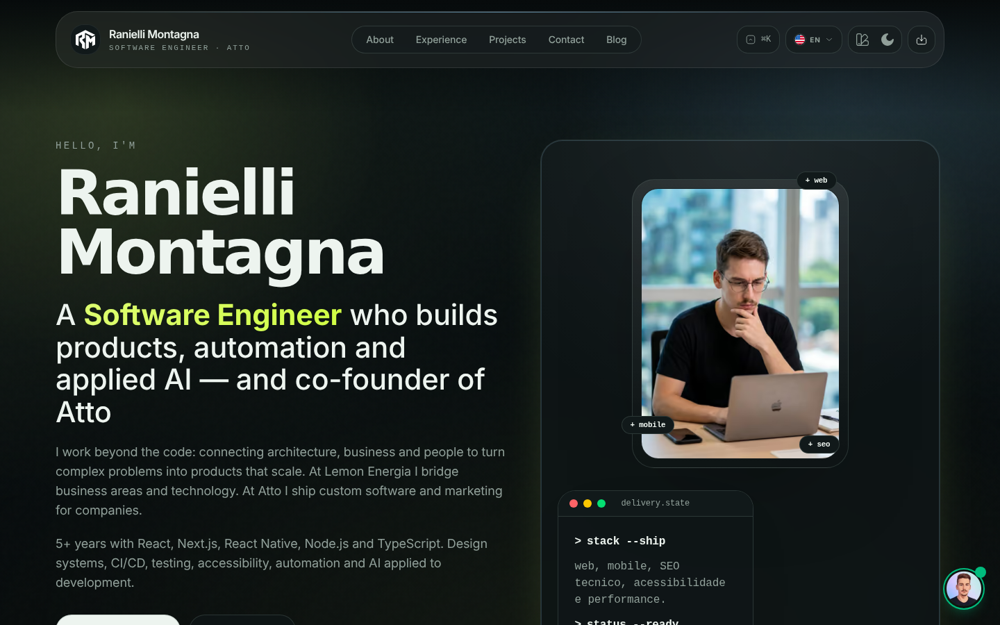
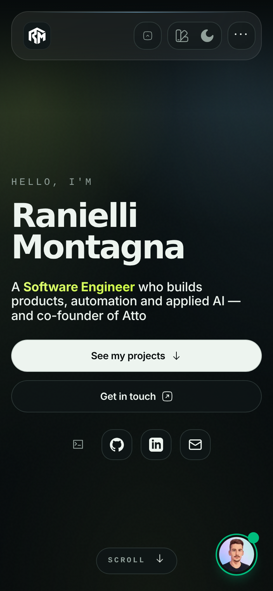

<div align="center">
  <picture>
    <source media="(prefers-color-scheme: dark)" srcset="./public/logo/white.svg" />
    
  </picture>

  <h1>ranimontagna.com</h1>

  <p>Personal portfolio and blog of Ranielli Montagna, built with Next.js, React and TypeScript.</p>

  <p>
    <a href="https://github.com/raniellimontagna/ranimontagna.com/actions/workflows/lint-ant-test.yml"></a>
    <a href="LICENSE"></a>
    
    
    
  </p>

  <p><strong>Live:</strong> <a href="https://ranimontagna.com">ranimontagna.com</a></p>
</div>

<table>
  <tr>
    <td width="72%" valign="top">
      
    </td>
    <td width="28%" valign="top">
      
    </td>
  </tr>
</table>

## Features

- **Three languages.** Portuguese (default, served at `/`), English (`/en`) and Spanish (`/es`) with `next-intl`.
- **AI chat.** A chat widget answers questions about Ranielli's public profile, career and projects. `POST /api/chat` uses DeepSeek, with optional Gemini, OpenRouter and Groq fallbacks, validates each answer before streaming it and rate-limits visitors. See [docs/ai-chat.md](docs/ai-chat.md) (Portuguese).
- **Blog.** Posts live in the public [ranimontagna-blog-content](https://github.com/raniellimontagna/ranimontagna-blog-content) repository and are read at runtime through the GitHub API, cached, and refreshed by a signed webhook on `POST /api/revalidate`. Posts are validated before rendering, support GitHub Flavored Markdown and Mermaid diagrams, and include an image lightbox and a reading progress bar.
- **Projects page.** `/projects` lists projects with a language filter and live GitHub stats (public repos, stars, followers).
- **Hidden retro modes.** Small icons around the page switch the whole site, blog and projects included, into a 1998 look, Windows XP, a DOS prompt with working commands, a Game Boy, a newspaper, an IDE or a classic Macintosh. The choice lasts for the browser session.
- **Theming.** Light and dark mode plus nine accent color themes.
- **Command menu.** `Cmd+K` / `Ctrl+K` for navigation, theme switching and social links.
- **Animated background.** A WebGL shader (three.js via React Three Fiber) that loads only after the first interaction and falls back to a static background when WebGL is missing or reduced motion is on.
- **CV downloads.** PDF résumés in Portuguese, English and Spanish under `/cv/`, generated by `scripts/generate-cv.py`.
- **Contact form.** `POST /api/contact` forwards messages through Formly, with rate limiting.
- **Machine-readable profile.** `/llms.txt`, `/llms-full.txt`, JSON-LD and a sitemap.
- **Monitoring.** Sentry for errors and Vercel Speed Insights for performance.

## Tech stack

| Area | Tools |
| --- | --- |
| Framework | Next.js 16 (App Router, Turbopack), React 19, TypeScript |
| Styling | Tailwind CSS 4 |
| Motion and 3D | Motion (`motion/react`), GSAP, three.js with React Three Fiber |
| State | Zustand |
| i18n | next-intl |
| Content | MDX via next-mdx-remote, remark-gfm, Mermaid, Octokit |
| UI primitives | Radix UI Dialog, cmdk |
| Validation | Zod |
| Rate limiting and blog cache | Upstash Redis (REST) |
| Monitoring | Sentry, Vercel Speed Insights |
| Quality | Biome, Vitest, Testing Library, Knip, Lighthouse CI |
| Hosting | Vercel |

## Getting started

Prerequisites: Node.js 24 (the version CI uses) and pnpm 11.

```bash
git clone https://github.com/raniellimontagna/ranimontagna.com.git
cd ranimontagna.com
pnpm install
cp .env.example .env.local   # fill in the services you want to use
pnpm dev
```

The site runs at `http://localhost:3000`. Every environment variable is described in [`.env.example`](.env.example): the blog, chat, contact form, cache and Sentry each need their own keys.

## Scripts

| Command | What it does |
| --- | --- |
| `pnpm dev` | Start the dev server with Turbopack |
| `pnpm build` | Production build, then add V8 compile hints to the startup scripts |
| `pnpm start` | Serve the production build |
| `pnpm lint` | Lint with Biome |
| `pnpm check` / `pnpm check:fix` | Biome lint and format check, without or with fixes |
| `pnpm typecheck` | Type-check without emitting files |
| `pnpm test` / `pnpm test:coverage` | Run the Vitest suite, optionally with coverage |
| `pnpm knip` | Find unused files, exports and dependencies |
| `pnpm lighthouse:local` | Run a Lighthouse CI audit locally |
| `pnpm chat:eval` | Run the live evaluation corpus against the chat provider |
| `pnpm cv:generate` | Rebuild the CV PDFs from `scripts/cv-content.json` (Python 3, ReportLab, macOS system fonts) |

CI ([`lint-ant-test.yml`](.github/workflows/lint-ant-test.yml)) runs the dependency audit, lint, typecheck, Knip, tests with coverage, the build and a Lighthouse audit on every push and pull request to `main`. Releases are managed by release-please.

## Project structure

```text
src/
├── app/          # Routes: [locale] pages, api/chat, api/contact, api/revalidate, llms-full.txt
├── features/     # Feature modules: home, blog, projects
└── shared/       # Shared components (layout, UI, retro modes, background), config, lib, services, stores
messages/         # Translations: pt, en, es
public/           # Logos, CV PDFs, images, retro assets, llms.txt
scripts/          # Build compile hints, chat evaluation, CV generator
docs/             # Technical documentation
```

## Documentation

- [Architecture](docs/architecture.md): the feature-based architecture.
- [Folder structure](docs/folder-structure.md): where files live and where new ones go.
- [Coding standards](docs/coding-standards.md): conventions used in the codebase.
- [Testing](docs/testing.md): testing strategy and examples.
- [Internationalization](docs/i18n.md): adding languages and translations.
- [AI chat](docs/ai-chat.md): chat architecture, providers and safety rules (Portuguese).

## License

The code is released under the [MIT License](LICENSE). The site content (texts and personal images) and its visual design belong to Ranielli Montagna.
